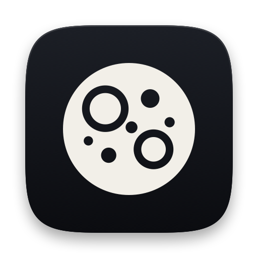

  

<h1 align="center">Moonpool</h1>

  A calm, Dynamic-Island-style notch for Apple Music on your Mac. 
  A personal project, forked from <a href="https://github.com/TheBoredTeam/boring.notch">Boring Notch</a> (GPL-3.0).

  
  

---

## What it is

A side project of mine: I wanted my notch to do a few things properly instead of a lot of things badly. It shows what Apple Music is playing, lets me control it, and tells me about the battery and the lock screen. It is not a widget board and doesn't want to be.

## Features

### Apple Music in the closed notch
- A small pill beside the notch shows the album art on one side and a live visualizer, tinted from the artwork, on the other.
- **Track changes announce themselves.** Whenever the song changes (a swipe, the media keys, or the song ending), the pill widens and the new artwork, title and artist roll up into place, hold for a moment, then fold away.
- **Swipe to skip.** Swipe left on the pill (two fingers on the trackpad, or click and drag) for the next track, right for the previous one. A skip arrow appears while you swipe, you get a firm haptic tick, and one swipe always skips exactly one song.
- **Pause and play states.** Pausing swaps the visualizer for a pause glyph and dims the artwork. After a short wait the pill folds back into the notch. Resuming shows a play glyph before the visualizer returns.

### The expanded player
Click the notch or swipe down on it to open a compact player:
- Album art, a scrolling title and the artist.
- A scrubber you can drag, with the elapsed time on the left and the time remaining on the right.
- Previous, play/pause and next, with a soft pressed animation.
- It only opens while Apple Music is playing (or has just been paused). With nothing playing, the notch stays out of the way.

### Lock and unlock animation
When you lock or unlock your Mac, a padlock appears beside the notch. Locking drops the shackle and fills the body in; unlocking lifts the shackle and leaves the body hollow, so the two states look different without relying on colour. It can also stay visible over the lock screen (optional).

### Battery and charging
The closed notch shows a short popup when your power state changes, with a drawn battery whose fill sweeps up to the real level:
- **Charging**, **Not charging**, **Plugged in**, **On battery**, **Fully charged**
- **Low battery**, at 20% and again at 10%
- **Low Power Mode on or off**

The open notch can also show the battery percentage. Colour is never the only signal: states also use a mark (bolt, plug, check, warning) and a label.

### Everywhere else
- Works on notched MacBooks and on other displays, on one display or all of them.
- Hides itself over fullscreen video.
- Menu bar icon (a cratered moon), launch at login, optional haptics.
- Respects macOS **Reduce Motion**: movement is replaced with simple fades.
- Animations are driven by the system where possible, so the notch uses almost no CPU while idle.

### What it deliberately does not do
No volume or brightness HUD, no file shelf, no clipboard manager, no calendar, no weather, and no support for music apps other than Apple Music. Fewer things, done carefully, is the whole idea.

## Requirements
- macOS 14 (Sonoma) or later
- Apple Music (the Music app)

## Settings
Open **Settings** from the menu bar icon or by right-clicking the notch.

| Tab | What you can change |
|---|---|
| General | Menu bar icon, launch at login, which display to use, follow the active display |
| Notch | Haptics, lock animation, show on the lock screen, hide from screen recording, notch height |
| Music | Tint text with the album colour, colour the visualizer, glow behind the artwork, progress bar colour |
| Battery | Show the battery and percentage in the open notch, show power-change popups |

## Privacy
Moonpool has **no network access** (the app sandbox is on and no network permission is requested) and collects no data. It reads your Music app's current track and controls playback through macOS Apple Events, and it reads battery and power state from the system. Nothing leaves your Mac.
